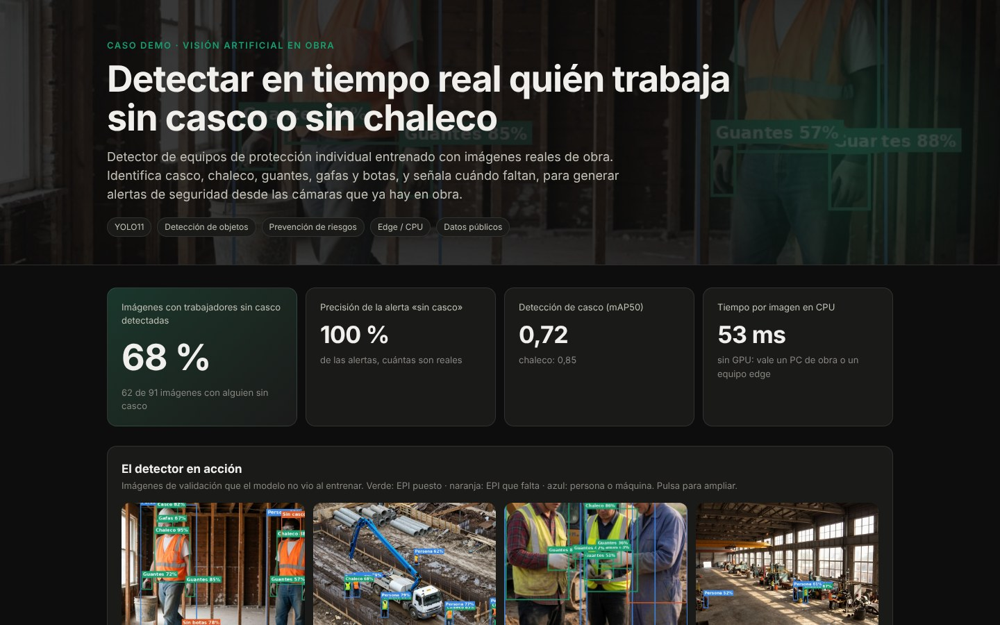

# Computer vision for construction-site safety: PPE detection

**Interactive dashboard:** [English](https://alvaromcib.github.io/vision-epis-obra/en/) · [Español](https://alvaromcib.github.io/vision-epis-obra/)



A detector that identifies **helmets, vests, gloves, goggles and boots** in construction-site images, and also when they are **missing**, to raise health-and-safety alerts from the cameras already on site. A lightweight model that runs **on CPU**, with no GPU or cloud services.

Demo project built on Ultralytics' public Construction-PPE dataset. No client data is used.

## Results (200 validation images)

| Metric | Value |
|---|---|
| Images with someone without a helmet that trigger an alert | 62 of 91 (68%) |
| "No helmet" false alarms | 0 of 109 images |
| mAP50 helmet / vest / person | 0.72 / 0.85 / 0.89 |
| Overall mAP50 (12 classes) | 0.66 |
| Time per image on CPU | ~53 ms |

The alert is calibrated not to bother anyone with false alarms. In production it is confirmed over several consecutive frames, which raises real detection per person and event. Classes with few examples (for example "no goggles") need more of the client's own data to be reliable.

## Structure

- `src/train.sh`: fine-tunes YOLO11n on the dataset (15 epochs, 448 px, CPU).
- `src/report.py`: per-class evaluation, per-image alert, timings and annotated examples.
- `src/annotate_en.py`: redraws the same examples with English labels for the English dashboard.
- `models/epis_yolo11n.pt`: trained weights (2.6 M parameters).
- `docs/`: self-contained dashboard (Spanish at the root, English in `docs/en/`).

```bash
pip install -r requirements.txt
yolo detect predict model=models/epis_yolo11n.pt source=your_image.jpg imgsz=448
```

## How it would apply on a construction site

1. Existing IP cameras (RTSP) or one camera per critical area.
2. The detector on a local PC or an edge device: video never leaves the site.
3. Alerts to the health-and-safety manager and an incident log by area and time slot.
4. Fine-tuning with the site's own images: uniforms, helmet colours, lighting.

---

**Álvaro Martín Coll** · Physicist · AI engineer for industry and construction · [Malt profile](https://www.malt.com/profile/alvaromartincoll)

Data and base model: [Ultralytics](https://docs.ultralytics.com/datasets/detect/construction-ppe/) (AGPL-3.0). This repository is distributed under AGPL-3.0.
